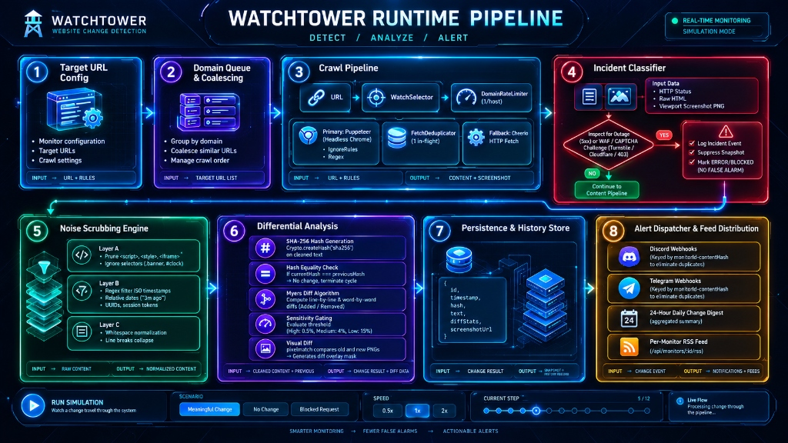

# WatchTower — Autonomous Website Change Detection & Diff Engine

**Track website mutations, pricing changes, and legal updates with zero false alarms.**

- **Live Application (Vercel):** [https://watchtower-website-change-detector.vercel.app/](https://watchtower-website-change-detector.vercel.app/)  
- **Production Backend API (Render):** [https://watchtower-website-change-detector-v2.onrender.com](https://watchtower-website-change-detector-v2.onrender.com)  
- **GitHub Repository:** [https://github.com/kartheekuppaluri-arch/watchtower-website-change-detector](https://github.com/kartheekuppaluri-arch/watchtower-website-change-detector)

---

WatchTower is a full-stack, production-grade web application for monitoring public websites, comparing captured versions with Myers semantic diffs and pixel-level visual comparison, and highlighting critical changes that matter. It combines an interactive React dashboard, a cinematic 3D product showcase, a resilient crawling pipeline (Headless Chromium + Cheerio fallback), deterministic 3-layer noise scrubbing, and real-time alert dispatching (Discord, Telegram, RSS, and Daily Digest).

---

## The Core Problem & Architectural Solutions

Naive website change detectors trigger endless false alarms whenever a page contains clocks, timestamps (*"3 minutes ago"*), dynamic session tokens, or viewer counters (*"14 people viewing"*). Furthermore, when a site suffers a temporary outage (HTTP 503) or displays a Cloudflare CAPTCHA, basic tools report that the entire page "changed" — flooding users with false notifications.

WatchTower solves these challenges with a verified 8-stage runtime pipeline:

| Engineering Challenge | WatchTower Architectural Solution | Codebase Reference |
| :--- | :--- | :--- |
| **1. Is an outage or CAPTCHA a change?** | **Incident Classifier & False-Alarm Suppression.** HTTP 5xx errors and Cloudflare/Turnstile/CAPTCHA challenges are classified as Incidents. Snapshot mutation is suppressed, preserving the healthy baseline. | `server/engine/crawler.js` (`inspectForOutageOrCaptcha`) |
| **2. Redundant fetching on shared targets?** | **Shared Request Coalescing (`FetchDeduplicator`).** If multiple users watch the exact same target URL, concurrent checks are coalesced into a single in-flight crawl job. | `server/engine/scheduler.js` (`FetchDeduplicator`) |
| **3. Ephemeral dates and counter noise?** | **3-Layer Deterministic Noise Scrubbing.** Layer A removes `<script>`, `<style>`, `<iframe>`, and CSS ignore selectors. Layer B strips ISO/relative timestamps, UUIDs, and CSRF tokens via regex. Layer C collapses whitespace. | `server/engine/noiseFilter.js` (`cleanTextNoise`) |
| **4. Server hammering & rate limits?** | **Per-Domain Rate Limiter (`DomainRateLimiter`).** Enforces a concurrency limit of 1 per hostname with polite crawl delays (1500ms) to respect target servers. | `server/engine/scheduler.js` (`DomainRateLimiter`) |

---

## 8-Stage Runtime Pipeline Architecture

[](public/architecture-pipeline.jpg)

The verified 8-stage verification pipeline executes in strict sequential order:
1. **Target URL Config** — Monitor configuration, target URLs, crawl settings (`WatchSelector`, `ignoreSelectors`, cadence).
2. **Domain Queue & Coalescing** — `DomainRateLimiter` (1 per hostname, 1500ms delay) & `FetchDeduplicator` (coalesces duplicate in-flight crawls).
3. **Crawl Pipeline** — Puppeteer Headless Chromium (1280×800 viewport), screenshot capture, and Cheerio HTTP fallback.
4. **Incident Classifier** — Inspects for HTTP 5xx outages and Cloudflare/Turnstile/CAPTCHA challenges; branches to **Log Incident Event** & **Suppress Snapshot (No False Alarm)** or continues to content scrubbing.
5. **Noise Scrubbing Engine** — 3 deterministic layers: Layer A (DOM pruning), Layer B (regex date/token filter), and Layer C (whitespace collapse).
6. **Differential Analysis** — SHA-256 fingerprinting, hash equality short-circuit (<1ms), Myers line/word diffing, sensitivity gating, and pixelmatch visual overlay masks.
7. **Persistence & History Store** — Writes immutable snapshot record (`id`, `timestamp`, `hash`, `text`, `diffStats`, `screenshotUrl`).
8. **Alert Dispatcher & Feed Distribution** — Discord & Telegram webhooks (hash-deduplicated), 24-hour daily change digests, and per-monitor RSS feeds (`/api/monitors/:id/rss`).

---

## Key Features

- **Autonomous Headless Browser Crawling:** Full Puppeteer Chromium rendering at 1280×800 viewport with network idle detection, paired with a lightweight Cheerio HTTP fetch fallback for serverless runtimes.
- **Visual Selector Picker:** Point-and-click DOM selector inspector allowing users to isolate specific targets (`#pricing`, `.legal-terms`, `article`) and exclude noisy regions (`.banner`, `#live-clock`).
- **Cryptographic Fingerprinting & Equality Short-Circuit:** Generates SHA-256 hashes of deterministic text streams. If hashes match, the cycle terminates in <1ms without running expensive diff algorithms.
- **Dual Semantic & Visual Diffing:**
  - **Myers Algorithm:** Word-by-word and line-by-line diffs with green `+` additions and red `-` deletions.
  - **Pixelmatch Visual Diff:** Pixel-level comparison with neon magenta mask overlays to spot layout and visual regressions.
- **Configurable Sensitivity Gating:** Set custom thresholds (High 0.5%, Medium 4%, Low 15%) so trivial one-letter edits don't trigger alerts unless requested.
- **Incident vs. Change Separation:** Distinguishes 5xx server downtime and Cloudflare Turnstile/CAPTCHA challenges from legitimate content edits.
- **Multi-Channel Alert Distribution:**
  - **Discord Webhooks:** Rich embeds with change summaries, diff stats, and screenshot previews.
  - **Telegram Bot Webhooks:** Instant markdown notifications with diff review links.
  - **Daily Change Digest:** Consolidated 24-hour executive summary.
  - **Per-Monitor RSS Feed:** Standalone XML feeds (`/api/monitors/:id/rss`) compatible with Slack, Feedly, and Zapier.
- **Live Test Studio:** Built-in mock targets (`/mock/store`, `/mock/news`, `/mock/status`) to simulate price drops, restocks, and server outages directly in the app.
- **Cinematic Visual Identity:** Premium dark glassmorphic interface with an organic watercolor sunset color palette, interactive GSAP-powered 3D scroll story, and dynamic typing effects.

---

## Technology Stack

| Layer | Technologies |
| :--- | :--- |
| **Frontend SPA** | React 19, Vite, Vanilla CSS Design System, Lucide Icons, GSAP (ScrollTrigger & 3D tilt) |
| **Backend Gateway** | Node.js, Express, CORS, RESTful JSON API |
| **Crawling Engine** | Puppeteer-Core (Headless Chrome), Cheerio (Fast HTML parser) |
| **Diff & Visual Analysis** | `diff` (Myers Algorithm), `pixelmatch`, `pngjs`, Node.js `crypto` (SHA-256) |
| **Persistence & Database** | SQLite (with file-backed JSON ledger fallback for serverless deployments) |
| **Deployment** | Vercel (Frontend SPA & Edge Rewrites), Render (Persistent Node.js Backend Engine) |

---

## API Reference

The backend API is accessible locally at `http://localhost:3001` or via the production Render backend at `https://watchtower-website-change-detector-v2.onrender.com`.

| Endpoint | Method | Description |
| :--- | :--- | :--- |
| `/api/` | `GET` | API health check and platform runtime diagnostics |
| `/api/monitors` | `GET` | List all monitored targets with snapshot and incident statistics |
| `/api/monitors` | `POST` | Register a new monitored URL with selectors, schedule, and sensitivity |
| `/api/monitors/:id` | `GET` | Retrieve monitor details, latest snapshot, and change history |
| `/api/monitors/:id` | `PUT` | Update monitor configuration, interval, or active state |
| `/api/monitors/:id` | `DELETE` | Delete a monitor and its historical snapshots |
| `/api/monitors/:id/check` | `POST` | Trigger an immediate manual crawl and diff cycle for a monitor |
| `/api/monitors/check-all` | `POST` / `GET` | Run crawl checks across all active monitors (used by cron jobs) |
| `/api/diff/compare` | `POST` | Compute Myers text diff and pixelmatch visual comparison between snapshots |
| `/api/picker/inspect` | `POST` | Inspect remote page DOM structure for visual selector configuration |
| `/api/alerts/test-webhook` | `POST` | Send a test payload to Discord or Telegram webhooks |
| `/api/monitors/:id/rss` | `GET` | Per-monitor RSS 2.0 XML feed of change events |
| `/api/digest` | `GET` | Aggregate 24-hour change digest across all monitors |
| `/mock/store` | `GET` | Mock e-commerce product page for testing price and stock changes |
| `/mock/news` | `GET` | Mock news outlet with dynamic timestamps and breaking news alerts |
| `/mock/status` | `GET` | Mock server status page for testing 200 OK vs 503 Outage transitions |

---

## Running Locally

### Prerequisites

- **Node.js** (v18 or later)
- **npm** (v9 or later)
- **Google Chrome** or **Microsoft Edge** (for full headless screenshot capture)

### Quick Start

1. **Clone the repository:**
   ```bash
   git clone https://github.com/kartheekuppaluri-arch/watchtower-website-change-detector.git
   cd watchtower-website-change-detector
   ```

2. **Install dependencies:**
   ```bash
   npm install
   ```

3. **Configure Environment (Optional):**
   Copy `.env.example` to `.env` if custom ports or remote backend endpoints are required:
   ```bash
   # Default local development uses Vite proxy to localhost:3001
   VITE_API_BASE_URL=
   PORT=3001
   ```

4. **Start the Development Server:**
   ```bash
   npm run dev
   ```
   This runs both the Express backend (`localhost:3001`) and the Vite React frontend (`localhost:5173`) concurrently.

5. **Open in Browser:**
   - **Frontend App:** [http://localhost:5173](http://localhost:5173)
   - **Main Dashboard:** [http://localhost:5173/#dashboard](http://localhost:5173/#dashboard)
   - **Architecture & About:** [http://localhost:5173/#about](http://localhost:5173/#about)
   - **Backend API:** [http://localhost:3001/api](http://localhost:3001/api)

### Production Build

To verify compilation and create the optimized production bundle:
```bash
npm run build
```

---

## Project Structure

```text
watchtower-website-change-detector/
├── public/
│   └── architecture-pipeline.jpg  # 8-Stage Architecture Blueprint Diagram
├── server/
│   ├── engine/
│   │   ├── alerts.js              # Discord, Telegram, Daily Digest & RSS dispatching
│   │   ├── crawler.js             # Puppeteer Chromium rendering & Cheerio fallback
│   │   ├── differ.js              # Myers text diffing, pixelmatch & AI change summaries
│   │   ├── noiseFilter.js         # 3-Layer DOM and regex text sanitization
│   │   └── scheduler.js           # DomainRateLimiter & FetchDeduplicator coalescing
│   ├── db.js                      # Persistence layer (SQLite + JSON fallback)
│   ├── index.js                   # Express server entry point & API router
│   └── mockServer.js              # Mock store, news, and status test targets
├── src/
│   ├── components/
│   │   ├── landing/               # 3D Hero, ScrollStory, Capabilities, Architecture
│   │   │   ├── ArchitectureFlow.jsx # Embedded architecture diagram showcase
│   │   │   ├── CinematicScrollStory.jsx
│   │   │   ├── DimensionalFeatures.jsx
│   │   │   ├── Hero3D.jsx         # 3D viewport with dynamic typewriter effect
│   │   │   └── LandingPage.jsx
│   │   ├── AboutPage.jsx          # Comprehensive engineering & architectural write-up
│   │   ├── AddMonitorModal.jsx    # Target URL, selectors, cadence & sensitivity modal
│   │   ├── AlertSettingsModal.jsx # Discord & Telegram webhook configuration
│   │   ├── DiffModal.jsx          # Side-by-side Myers diff viewer & visual overlays
│   │   ├── Header.jsx             # Top bar, stats counters & view navigation
│   │   ├── MonitorCard.jsx        # Individual monitor card with action controls
│   │   ├── TestStudio.jsx         # Live interactive mock test laboratory
│   │   ├── TimelineModal.jsx      # Snapshot history and time-travel chart
│   │   └── VisualPickerModal.jsx  # Interactive DOM point-and-click element picker
│   ├── api.js                     # Unified API helper supporting VITE_API_BASE_URL
│   ├── App.jsx                    # Primary application router & state manager
│   ├── index.css                  # Global design system & watercolor sunset theme
│   ├── landing.css                # Cinematic 3D landing page styling & keyframes
│   └── main.jsx                   # React 19 entry point
├── package.json
├── vite.config.js
└── README.md
```

---

## Author

**Kartheek Uppaluri**  
Computer Science and Engineering, VIT Vellore  
- **GitHub:** [@kartheekuppaluri-arch](https://github.com/kartheekuppaluri-arch)  
- **Project Link:** [https://github.com/kartheekuppaluri-arch/watchtower-website-change-detector](https://github.com/kartheekuppaluri-arch/watchtower-website-change-detector)
